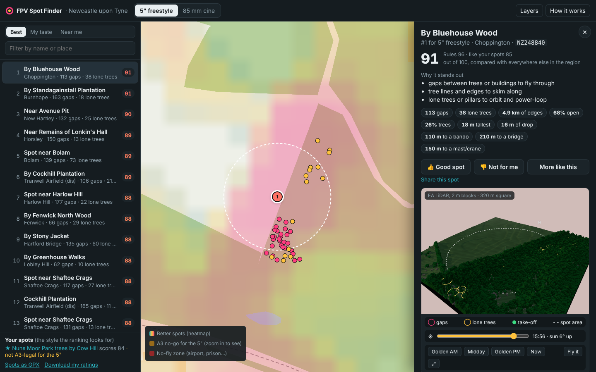

# FPV Spot Finder

Finds places worth flying an FPV quad in the UK, and tells you straight away whether you're allowed to.

It doesn't look at satellite photos. Every 50 m square of a region gets measured from 1 m height data
(trees, buildings, gaps between them) and map data (land use, water, bridges, bandos, airspace),
then scored on the things pilots actually look for. Spots you already like steer the ranking, and so
do your 👍 / 👎 in the app.

Two drone profiles out of the box:

| Profile | Drone | UK category | What it hunts for |
|---|---|---|---|
| `freestyle5` | 5", 800 g with battery and action cam, no class mark | Open **A3** | gaps, lone trees, tree lines, open ground, drops, bandos, all on A3-legal ground |
| `cine85` | 85 mm cinewhoop, under 250 g | Open **A1** | architecture, whoop-sized gaps, plazas, trees, water, bridges, landmarks |



## What's in the app

- **Map** with a heatmap of good areas, numbered pins for the top spots, airport/prison flight
  restriction zones, and (zoomed in) where the 5" can't fly under A3.
- **Spot cards**: why it scored (in words and as a breakdown), what's there (gaps, lone trees,
  edges, tallest thing, drop, distance to water/bando/bridge), a suggested take-off point, the
  legal picture for that drone, land-owner warnings, sunrise/golden hour, and an 18-hour wind and
  rain strip from Open-Meteo.
- **3D model of each top spot** (320 m square at 2 m) with the real sun for today: drag the slider
  through the day to see where the shadows and golden light fall. Pink rings are the detected gaps,
  yellow loops the lone trees, green the take-off.
- **Fly it**: a tiny sim inside the 3D model. Keyboard flies in angle mode with climb-rate hold;
  plug your radio in as a USB joystick (EdgeTX/OpenTX "USB Joystick") and it flies acro on the sticks,
  with 5" or whoop-ish rates. Fly through the gap rings to tick them off.
- **Can I fly here?**: tap anywhere on the map for a verdict for both drones, with reasons.
- **Ratings**: 👍 / 👎 any spot. "My taste" re-ranks the list with a small model trained on your
  ratings; "More like this" finds spots similar to one you like. Ratings stay in your browser and can
  be exported and fed back into the pipeline.
- **Works offline** once loaded (add it to your home screen). When the online map can't load, it
  switches to a built-in basemap (main roads, rail, water, woods, built-up areas, place names), so it
  still works in a field with no signal. **GPX export** of the spots for OS Maps or a GPS, and a share
  link for each spot.
- Links out to Geograph (people's ground-level photos of that 1 km square, often the quickest way
  to judge a place), Street View, satellite and OS Maps.

## Running it

### Just the app (Newcastle data is in the repo)

```bash
cd web
npm install
npm run dev          # http://localhost:5173
```

`npm run build` makes a static site in `web/dist/` you can host anywhere (GitHub Pages, Netlify, a
phone on the same Wi-Fi with `npm run preview -- --host`).

### The pipeline (to re-score, change rules, or add a region)

Python 3.11+.

```bash
python -m venv .venv && . .venv/bin/activate
pip install -e ".[dev]"
```

Put two things in `data/static/` first (both free):

- `data/static/osm/`: Geofabrik county extracts covering the region, e.g. `tyne-and-wear`,
  `northumberland` and `durham` from <https://download.geofabrik.de/europe/united-kingdom/england.html>.
- `data/static/nats/`: the NATS UAS restriction zones KMZ (`EG_UAS_FR_DS_AREA1_FULL_YYYYMMDD.kmz`)
  from the NATS AIS digital datasets page. The newest one already in force is used, so drop the next
  AIRAC file in whenever it's published.

Everything else downloads itself and is cached in `data/cache/<region>/`:

- Overture Maps buildings, roads, land use, places (from their public S3 bucket),
- Meta / WRI 1 m global canopy height (public S3) as the fallback height model,
- AWS terrain tiles for ground height.

```bash
python -m spotfinder run --region newcastle      # everything: ~10 min for 40 x 40 km
python -m spotfinder score --region newcastle    # just re-score + re-export (~1 min)
python -m spotfinder legal --region newcastle    # just the legal grids, e.g. after a new AIRAC (~4 min)
pytest                                           # quick checks
```

Outputs land in `web/public/data/<region>/`, which is what the app reads.

### LiDAR (much better heights)

The Environment Agency's national LiDAR is hundreds of GB as downloads, so this doesn't download it.
It asks the EA's Web Coverage Service for just the 1 km squares it needs and keeps a compact version
(about 1.5 MB per km²):

```bash
python -m spotfinder lidar --region newcastle --top 60   # only under the best 60 spots per drone
python -m spotfinder lidar --region newcastle            # the whole region (~1600 squares, ~15 min)
python -m spotfinder features && python -m spotfinder score
```

Squares without LiDAR fall back to the tree-height model, so a partial fetch is fine. Each spot card
says which heights it used.

### Teach it your taste

In the app, 👍 / 👎 re-rank the list straight away ("My taste"). To make the whole region learn,
not just the 250 listed spots: **Download my ratings** (bottom left), save the file as
`config/ratings/<region>.json` and run `python -m spotfinder score`. Thumbs-up spots become extra
seeds; places like your thumbs-down spots get pulled down.

### New region or new favourite spots

- Regions: add a box to `config/regions.toml` (British National Grid metres, whole km).
- Your spots: add them to `config/seeds.toml` with a profile; the ranking looks for places with a
  similar mix of features. A seed doesn't need to be legal for that drone (the Nuns Moor seed isn't,
  for the 5"); it only describes style. Each seed is matched on its own, so a woodland seed and a
  bando seed don't blur into one average.
- Rules and weights: `spotfinder/scoring.py`. Legal distances and land-owner flags:
  `spotfinder/legal.py`.

## How the scoring works

1. **Heights at 1 m**: EA LiDAR first-return surface minus bare earth where available; otherwise
   Meta's tree-height model plus Overture building heights.
2. **Geometry per 1 km tile**: tall = 4 m and up. Gaps are found by closing the tall mask (5 m) and
   keeping the bits that were open: 2-12 m wide, both sides at least 5 m tall. Lone trees are tall
   blobs with at least 80% open ground in a 10 m ring. Edges are tall pixels touching open ground.
   With LiDAR, the difference between first and last returns finds room under the canopy.
3. **Context** from OSM and Overture: distance to water, bridges and viaducts, bandos (ruins,
   abandoned/disused structures), cliffs and quarries, landmarks, masts and cranes, paths, car parks;
   and how busy a place is.
4. **Legal grid at 5 m**: A3 needs 150 m from residential, commercial, industrial and recreational
   land and 50 m from buildings and busy roads; flight restriction zones and restricted areas block
   both drones. MOD land and danger areas are never suggested, and nor is anywhere a spot would
   reach onto them. National Trust, Forestry England, Woodland Trust, nature reserves, golf courses,
   cemeteries, railways (not ones in tunnels) and power lines are flagged.
5. **Score**: a weighted rule score (only counting features on ground the drone may legally use),
   blended 60/40 with similarity to your seed spots. Legality is a gate, not a weight. Spots are
   picked greedily with a minimum spacing (400 m for the 5", 250 m for the whoop).

## Be real about it

- It knows what the data knows. Fences, "no drones" signs, livestock, nesting birds, crowds on the
  day and private land aren't in it. Go and look first, and take a spotter when you fly in goggles.
- Land use and land owners come from OpenStreetMap. If a park or a National Trust boundary isn't
  mapped, it isn't known here. Chopwell Wood, for example, has no operator tag in OSM, so it isn't
  flagged as Forestry England land.
- Without LiDAR, trees under ~4 m and narrow gaps get missed and building heights are estimates.
- The A3 check is distance-based and a bit conservative around edges (20 m pixels). The "can I fly
  here" verdict is a planning aid, not legal advice: check the CAA Drone Code and a drone safety map
  app before you fly.
- Wind limits for the flyable/not strip are a judgement call (gusts under ~28 mph for the 5", ~12 mph
  for the whoop).

## Data and licences

OpenStreetMap contributors (ODbL), Overture Maps Foundation (CDLA-Permissive / ODbL layers),
Meta & World Resources Institute canopy height (CC BY 4.0), Environment Agency LiDAR (Open Government
Licence), NATS UAS restriction zones, AWS Terrain Tiles (various open sources), Open-Meteo (CC BY 4.0).
